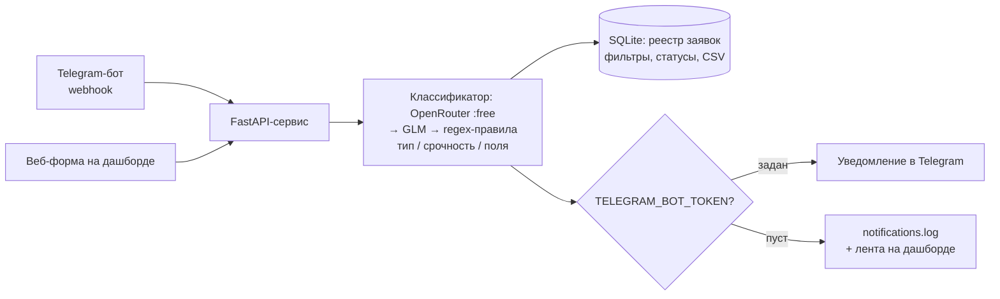

# Lead Orchestrator — агент-оркестратор заявок

Демо-кейс для портфолио. Позиционирование: **backend-разработчик, встраивающий AI-агентов в реальную инфраструктуру** — не «нейросеть ради нейросети», а рабочий контур обработки заявок, который можно показать заказчику за 2 минуты.

> Проект демо. Все цифры — из локальных замеров, не продакшен.

## Задача

Малый бизнес принимает заявки клиентов в Telegram, после чего они теряются:

- заявки валяются в личке и чатах — никто не отвечает за «поток»;
- невозможно быстро понять, что это: вопрос о цене, техподдержка, жалоба или предложение о сотрудничестве;
- у ответственного нет единого реестра заявок и уведомлений о срочных.

Нужен автоматический контур: заявка попадает в бота → классифицируется → фиксируется в таблице → ответственный получает уведомление. Без ручного разбора входящих.

## Решение

**Python-сервис (FastAPI + SQLite)** — весь контур в одном процессе, демо работает локально без внешних сервисов:

1. Заявка приходит одним из двух каналов:
   - **Telegram webhook** `POST /webhook/telegram` — формат апдейтов Bot API, чтобы перенести в прод, достаточно подставить реальный токен и указать webhook у @BotFather;
   - **веб-форма** на дашборде (`POST /api/leads`).
2. **LLM-классификатор** определяет: **тип** (вопрос о цене / техподдержка / жалоба / сотрудничество / спам / другое), **срочность** (low / medium / high) и извлекает поля: **имя, контакт, суть в одном предложении**.
   Цепочка провайдеров: OpenRouter (бесплатная модель, JSON-выход, ретраи) → GLM (резерв) → **regex-правила** (детерминированный fallback, если оба API недоступны). Заявка не теряется никогда.
3. Заявка записывается в **SQLite**; на дашборде — таблица с фильтрами по типу/срочности/статусу, сменой статуса (new / in_progress / done) и **экспортом в CSV**.
4. **Уведомление** ответственному: реальный Telegram, если задан `TELEGRAM_BOT_TOKEN`; иначе — запись в `notifications.log` + лента «последние уведомления» на дашборде (режим мока, переключается env-ом без правок кода). Срочные — с пометкой «СРОЧНО», спам в реестр попадает, но ответственного не дёргает.

Для варианта «заказчик хочет визуальный workflow» в `docker-compose.yml` остаётся **n8n** (profile `n8n`, в демо не требуется).

Секреты — в `.env`, в репозитории только `.env.example`.

## Результат

Замеры демо (локально, тестовый набор `docs/test-leads.md`, 15 заявок; классификатор — `nvidia/nemotron-3-super-120b-a12b:free` через OpenRouter):

| Метрика | Значение (демо) |
|---|---|
| Точность классификации по типу | **15/15 = 100%** (первый прогон 14/15 — после уточнения промпта по спам-кейсу стало 15/15) |
| Точность по срочности | **15/15 = 100%** |
| Извлечение полей (имя / контакт) | **30/30 = 100%**, пустые поля не выдумываются |
| Суть (summary) непустая | 15/15 |
| Время обработки end-to-end (webhook → строка в реестре + уведомление) | **2,6–3,0 с** (3 замера: 2,62 / 2,81 / 2,99 с); среднее время LLM-вызова в прогоне набора — 3,1 с |
| Fallback на regex-правилах | те же 15/15 по типу, < 1 мс — контур жив даже при недоступности обоих LLM API |
| Автотесты (pytest) | 21 passed (fallback-правила, webhook, экспорт CSV, фильтры, статусы) |

Прогон воспроизводится: `set -a; source .env; set +a; .venv/bin/python scripts/eval_dataset.py` (LLM) или `--rules` (fallback). Сырые ответы — в `data/eval_results.json`.

## Схема работы

Подробная схема с компонентами — в [docs/architecture.md](docs/architecture.md).



## Стек

- **Python / FastAPI** — сервис целиком: приём, классификация, реестр, уведомления
- **OpenRouter API** — бесплатная LLM-модель (`nvidia/nemotron-3-super-120b-a12b:free`), резерв — GLM API (`glm-4-flash`)
- **SQLite** — реестр заявок (в прод-варианте слот под Google Sheets зарезервирован env-ом)
- **Telegram Bot API** — приём заявок и уведомления (в демо — режим мока)
- **Docker Compose** — запуск одной командой; n8n — опция через profile

## Как запустить

Три команды (нужны только заполненный `.env` и Docker):

```bash
cp .env.example .env    # вписать OPENROUTER_API_KEY (остальное опционально)
docker compose up       # сервис на http://localhost:8000
```

Открыть http://localhost:8000 — дашборд: форма слева, реестр справа, лента уведомлений. Отправить заявку из формы или curl-ом через webhook:

```bash
curl -X POST localhost:8000/webhook/telegram -H 'Content-Type: application/json' -d '{
  "update_id": 1,
  "message": {"message_id": 1, "from": {"id": 1, "first_name": "Ольга"},
              "chat": {"id": 1, "type": "private"}, "date": 1760000000,
              "text": "Ошибка оплаты: деньги списались, но заказ не оформился. Ольга +7 900 123-45-67"}
}'
```

Без Docker: `python -m venv .venv && .venv/bin/pip install -r requirements.txt`,
затем `set -a; source .env; set +a; .venv/bin/uvicorn app.main:app --port 8000`.

Переменные окружения: `OPENROUTER_API_KEY` (основной LLM), `GLM_API_KEY` (резерв), `TELEGRAM_BOT_TOKEN` + `TELEGRAM_CHAT_ID` (реальные уведомления; пустые — режим мока), опционально `OPENROUTER_MODEL`, `GLM_MODEL`, `LLM_TIMEOUT_S`, `DB_PATH`, `NOTIFICATIONS_LOG`.

Тесты: `.venv/bin/python -m pytest tests/ -q`. Прогон метрик: `scripts/eval_dataset.py` (см. «Результат»).

n8n (опция): `docker compose --profile n8n up` → http://localhost:5678.

## Вариант B — Kafka + микросервис

Для инженерно-сильной версии (по запросу): тот же контур с очередями —

- **Apache Kafka** — топики `leads.incoming` / `leads.classified`;
- приём, классификация и доставка — отдельные consumer-группы, горизонтальное масштабирование;
- DLQ для заявок, которые не удалось классифицировать после ретраев;
- наблюдаемость: consumer lag, время пребывания заявки в очереди.

Плюсы: масштабирование и гарантии доставки. Минусы: выше порог входа для заказчика. Реализуем по запросу — архитектура описана в [docs/architecture.md](docs/architecture.md).
