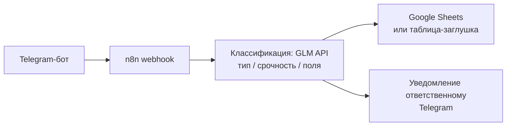

# Lead Orchestrator — агент-оркестратор заявок

Демо-кейс для портфолио. Позиционирование: **backend-разработчик, встраивающий AI-агентов в реальную инфраструктуру** — не «нейросеть ради нейросети», а рабочий контур обработки заявок, который можно показать заказчику за 2 минуты.

> Проект демо. Все цифры — из локальных замеров, не продакшен.

## Задача

Малый бизнес принимает заявки клиентов в Telegram, после чего они теряются:

- заявки валяются в личке и чатах — никто не отвечает за «поток»;
- невозможно быстро понять, что это: вопрос о цене, техподдержка, жалоба или предложение о сотрудничестве;
- у ответственного нет единого реестра заявок и уведомлений о срочных.

Нужен автоматический контур: заявка попадает в бота → классифицируется → фиксируется в таблице → ответственный получает уведомление. Без ручного разбора входящих.

## Решение

Оркестрация на **n8n** (визуальный workflow — заказчик понимает, что происходит, и может дорабатывать сам) + Python-функция классификации на **GLM API** (OpenAI-совместимый интерфейс):

1. Клиент пишет Telegram-боту.
2. n8n принимает сообщение через webhook.
3. Python-классификатор на GLM определяет: **тип** заявки (вопрос о цене / техподдержка / жалоба / сотрудничество / спам), **срочность** (low / medium / high) и извлекает поля: **имя, контакт, суть**.
4. Заявка записывается в Google Sheets (или таблицу-заглушку для демо).
5. Ответственный получает уведомление в Telegram; срочные — с пометкой.

Секреты — в `.env`, в репозитории только `.env.example`.

## Результат

**В разработке.** Цифры будут из локальных замеров (демо).

Что замеряем:

| Метрика | Как считаем |
|---|---|
| Время обработки заявки: от сообщения клиента до строки в таблице | таймстемпы Telegram-сообщения и записи в Sheets, секунд |
| Точность классификации по типу | прогон тестового набора ~30 заявок (`docs/test-leads.md`), доля верных типов |
| Полнота извлечения полей (имя / контакт / суть) | тот же прогон, доля корректно извлечённых полей |

## Схема работы

Подробная схема с компонентами — в [docs/architecture.md](docs/architecture.md).



## Стек

- **n8n** — оркестратор workflow (docker-compose, порт 5678)
- **Python** — функция классификации, OpenAI-совместимый клиент → GLM API (`https://open.bigmodel.cn/api/paas/v4`)
- **Google Sheets API** — реестр заявок (для демо — таблица-заглушка)
- **Telegram Bot API** — приём заявок и уведомления
- **Docker Compose** — локальный запуск одной командой

## Как запустить

```bash
cp .env.example .env        # заполнить ключи
docker compose up -d        # n8n поднимется на http://localhost:5678
```

1. Откройте n8n, импортируйте workflow (файл появится на вечере 2 плана — см. [docs/plan.md](docs/plan.md)).
2. Укажите переменные из `.env` в нодах workflow.
3. Напишите боту тестовую заявку — строка появится в таблице, ответственному придёт уведомление.

Для проверки классификатора без Telegram — скилл `lead-classifier-eval` и набор `docs/test-leads.md`.

## Вариант B — Kafka + микросервис

Для инженерно-сильной версии (по запросу): тот же контур без n8n —

- **Apache Kafka** — очередь `leads.incoming` / `leads.classified`;
- **Python-микросервис** (FastAPI + consumer) — классификация на GLM, ретраи, DLQ для нераспознанных заявок;
- записью в Sheets и уведомлениями занимается отдельный consumer.

Плюсы: горизонтальное масштабирование, гарантии доставки, наблюдаемость (lag метрики). Минусы: выше порог входа для заказчика. Реализуем по запросу — архитектура описана в [docs/architecture.md](docs/architecture.md).
