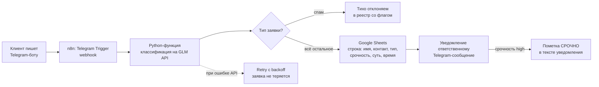
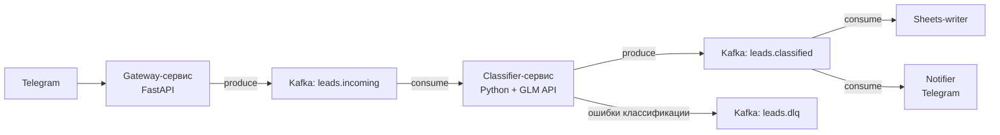

# Архитектура

## Основной вариант (n8n)

Поток по шагам:

1. **Telegram Trigger** — n8n слушает обновления бота, входящее сообщение = заявка.
2. **Классификация** — Python-функция вызывает GLM API (OpenAI-совместимый, `GLM_BASE_URL`) с промптом-схемой:
   - `type`: `price_question` | `support` | `complaint` | `partnership` | `spam`
   - `urgency`: `low` | `medium` | `high`
   - извлечение полей: `name`, `contact`, `summary` (суть заявки в одном предложении)
3. **Запись** — строка в Google Sheets (демо: таблица-заглушка / локальный CSV-эндпоинт).
4. **Уведомление** — Telegram-сообщение ответственному (`TELEGRAM_CHAT_ID`); `high` urgency — с пометкой «СРОЧНО».
5. **Надёжность** — retry с backoff на вызов LLM; заявка не теряется при временном отказе API.

Почему n8n: заказчик видит workflow целиком, может менять правила (например, маршрут жалоб) без программиста. LLM-логика изолирована в Python-функции — её можно тестировать отдельно от оркестратора (скилл `lead-classifier-eval`).

## Вариант B — Kafka + микросервис (по запросу)

Отличия от основного варианта:

- очередь `leads.incoming` / `leads.classified` развязывает приём, классификацию и доставку;
- consumer-группы позволяют масштабировать классификатор горизонтально;
- DLQ для заявок, которые не удалось классифицировать после ретраев;
- наблюдаемость: consumer lag, время пребывания заявки в очереди.

Когда вариант B оправдан: поток заявок выше возможностей одного n8n-инстанса, нужны гарантии доставки и аудит. Для демо-кейса избыточен — реализуем по запросу.
