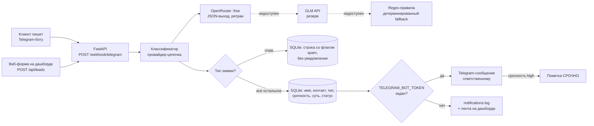
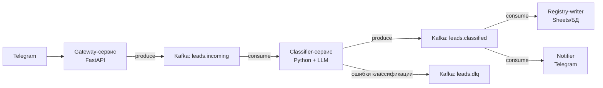

# Архитектура

## Основной вариант (Python-сервис)

Один FastAPI-процесс, развёртывается `docker compose up`. Все внешние интеграции вырождены
в локальные заглушки переключением env-переменных — демо не зависит от сети (кроме LLM-вызова,
для которого есть детерминированный fallback).

Поток по шагам:

1. **Приём** — два канала с одинаковым пайплайном: Telegram webhook (формат апдейтов Bot API, в прод —
   `setWebhook` с реальным токеном) и веб-форма на дашборде. Валидация и парсинг апдейта — `app/telegram.py`.
2. **Классификация** — `app/classifier.py`, цепочка провайдеров с единым контрактом выхода:
   - `type`: `price_question` | `support` | `complaint` | `partnership` | `spam` | `other`
   - `urgency`: `low` | `medium` | `high`
   - извлечение полей: `name`, `contact`, `summary` (суть одним предложением); отсутствующие поля — пустые строки, не выдумываются
   - OpenRouter (бесплатная модель, temperature 0, JSON-парсинг с валидацией, 2 попытки) → GLM (резерв, 2 попытки) → regex-правила (мгновенно, покрывают тест-набор)
3. **Запись** — SQLite (`data/leads.db`): полный текст, результат классификации, источник, провайдер,
   `processing_ms`, статус `new`. Дашборд: фильтры по типу/срочности/статусу, смена статуса, экспорт CSV.
4. **Уведомление** — `app/notifier.py`: реальный Telegram при заданном `TELEGRAM_BOT_TOKEN`
   (при ошибке отправки — автоматический откат в лог, заявка не теряется); иначе `notifications.log`
   + таблица `notifications` для ленты на дашборде. Спам подавляется. Клиенту в чат бот отвечает
   подтверждением с номером заявки.
5. **Надёжность** — ретраи с паузой на каждом LLM-провайдере, деградация до regex-правил;
   время обработки фиксируется в каждой строке реестра.

Почему не «всё на n8n»: LLM-логика с ретраями и fallback-правилами тестируется pytest-ом,
а оркестрация остаётся читаемым Python-сервисом. n8n оставлен опцией (docker profile `n8n`),
если заказчик хочет визуальные workflow.

## Дашборд

Тёмная тема (#0f172a, акценты #22d3ee → #8b5cf6), один экран: слева форма заявки, справа реестр
с бейджами срочности и лентой последних уведомлений. Обновление — fetch каждые 7 секунд.

## Вариант B — Kafka + микросервис (по запросу)

Отличия от основного варианта:

- топики `leads.incoming` / `leads.classified` развязывают приём, классификацию и доставку;
- consumer-группы позволяют масштабировать классификатор горизонтально;
- DLQ для заявок, которые не удалось классифицировать после ретраев;
- наблюдаемость: consumer lag, время пребывания заявки в очереди.

Когда вариант B оправдан: поток заявок выше возможностей одного сервиса, нужны гарантии доставки
и аудит. Для демо-кейса избыточен — реализуем по запросу.
